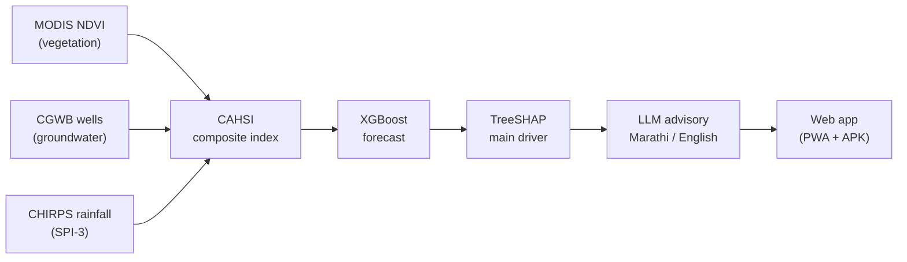

<p align="center">
  
</p>

<h1 align="center">BhoomiDrishti</h1>

<p align="center">
  <b>तुमच्या पिकासाठी लवकर इशारा — Early warning for your crop</b><br>
  Crop-stress early warning and Marathi advisory system for the 11 districts of Vidarbha, Maharashtra
</p>

<p align="center">
  <a href="https://bhoomi-drishti-sandy.vercel.app"><b>Open the live app</b></a> ·
  <a href="https://www.doi.org/10.56726/IRJMETS103718">Published paper</a>
</p>

---

## About the project

Farmers in Vidarbha grow cotton, soybean, tur, orange and wheat mostly under rainfed conditions, and one weak monsoon can damage all of them in the same season. Satellite, rainfall and groundwater data that could warn of this already exist, but they are looked at separately and never reach the farmer as simple, crop-specific advice.

BhoomiDrishti joins these three sources into one number, the **Composite Agro-Hydrological Stress Index (CAHSI)**, forecasts it one period ahead with machine learning, explains what is driving the stress, and gives the farmer a short advisory in **Marathi or English** through a web app that installs on phones and computers.

## Features

- **District and crop selection.** 11 Vidarbha districts and 5 crops (Cotton, Soybean, Tur, Wheat, Orange).
- **Stress level.** Low, Moderate or Severe, using crop-specific thresholds.
- **One-period-ahead forecast.** An XGBoost model predicts the next 16-day CAHSI value.
- **Main driver.** TreeSHAP shows which factor (rainfall deficit, vegetation health, recent trend) is driving the stress.
- **Farmer advisory.** A large language model writes a short, practical advisory in Marathi or English.
- **Crop calendar.** Sowing, critical stage and harvest windows for each crop.
- **District map.** Vidarbha districts coloured by stress level.
- **Installable app.** Installs on Android, PC and iPhone from the browser, and also as an Android APK.

## How it works



1. **Data.** MODIS vegetation anomaly (every 16 days), CGWB groundwater-level anomaly, and the 3-month Standardized Precipitation Index (SPI-3) from CHIRPS rainfall, for 2013–2022.
2. **Index.** CAHSI = 0.31 × vegetation + 0.22 × groundwater + 0.46 × rainfall. The weights come from Spearman correlations with 44 labelled district-years, not from assumption.
3. **Severity bands.** For each crop, the Severe and Moderate cut-offs are the 15th and 35th percentiles of CAHSI during that crop's season.
4. **Forecast and explanation.** XGBoost forecasts the next period, and TreeSHAP picks out the main driver.
5. **Advisory.** A Groq-hosted LLM (`openai/gpt-oss-120b`) turns the numbers into a short advisory for the farmer.

## Key results

| Measure | Result |
|---|---|
| Declared drought cases flagged before declaration | 15 of 15 (13 cotton, 2 orange) |
| Median lead time before declaration | 27.6 weeks |
| Forecast R², one period ahead (2021–2022 test) | 0.589 (persistence baseline 0.572) |
| Forecast R², index-history model | 0.675 |
| Crop stress band accuracy, one period ahead | 77–86% depending on crop |

**Limitations.** The rainfall component (SPI-3) dominates the index because the three inputs are on different scales. The forecast has no skill two periods ahead. The advisory has not yet been tested with farmers. The published paper discusses these points in detail.

## Tech stack

| Part | Technology |
|---|---|
| Data processing | Python, pandas, NumPy, Google Earth Engine |
| Machine learning | XGBoost, SHAP, scikit-learn |
| Advisory | Groq API (`openai/gpt-oss-120b`) |
| Backend | FastAPI, hosted on Render |
| Frontend | HTML, CSS, JavaScript (installable PWA), hosted on Vercel |
| Android app | Trusted Web Activity built with PWABuilder |

## Folder structure

```
BhoomiDrishti/
├── backend/              FastAPI server
│   ├── main.py           API endpoints
│   ├── cahsi_core.py     CAHSI lookup, XGBoost forecast, SHAP driver, crop calendar
│   └── advisory_llm.py   Marathi / English advisory generation
├── frontend/             Web app
│   ├── index.html, style.css, app.js
│   ├── manifest.json     makes the app installable
│   ├── icons/            app icons
│   └── .well-known/      Android app link file
├── src/                  Scripts to download and process data, train the model and run evaluations
├── data/
│   ├── processed/        Processed index data, trained models, metrics, SHAP plots
│   └── shapefiles/       District boundary files
└── requirements.txt      Python packages
```

The raw MODIS, CHIRPS and CGWB downloads are not included because of their size. The scripts in `src/` download and rebuild them.

## API endpoints

| Endpoint | What it returns |
|---|---|
| `GET /health` | Server status |
| `GET /cahsi/{district}/{crop}` | CAHSI score, severity and forecast |
| `GET /advisory/{district}/{crop}?lang=mr` | Main driver and advisory (`lang=en` for English) |
| `GET /crop-calendar/{crop}` | Sowing, critical stage and harvest windows |
| `GET /validation-history/{district}/{crop}` | Past drought declarations and lead times |

The `cahsi`, `advisory` and `crop-calendar` endpoints also accept `?as_of_date=YYYY-MM-DD` to look at a past date, for example `/advisory/Yavatmal/Cotton?as_of_date=2018-10-16`.

## How to run it on your computer

**You need:** Python 3.11 or newer and a free Groq API key from [console.groq.com](https://console.groq.com).

1. **Install the packages.** Open a terminal in the project folder and run:
   ```bash
   pip install -r requirements.txt
   ```
2. **Add your API key.** Create a file named `.env` in the project folder with this one line:
   ```
   GROQ_API_KEY=your_groq_key_here
   ```
3. **Start the backend:**
   ```bash
   cd backend
   uvicorn main:app --reload
   ```
   Open http://127.0.0.1:8000/docs to try the API in your browser.
4. **Start the frontend** (in a second terminal):
   ```bash
   cd frontend
   python -m http.server 5500
   ```
   Open http://127.0.0.1:5500.

> **Note:** The frontend uses the online backend by default. To make it use your local backend, change `API_BASE` at the top of `frontend/app.js` to `http://127.0.0.1:8000`, and add `"http://127.0.0.1:5500"` to `allow_origins` in `backend/main.py`.

## Install the app

- **Android, PC or iPhone:** open the [live app](https://bhoomi-drishti-sandy.vercel.app) and choose **Install app** (Chrome or Edge) or **Add to Home Screen** (Safari).
- **Android APK:** install `BhoomiDrishti.apk` and allow "Install unknown apps" if the phone asks.

## Publication

D. Deshmukh, R. Chafle, G. Pachpohar and N. S. Khachane, "BhoomiDrishti: A Composite Agro-Hydrological Stress Index for Early Crop Stress Prediction Using Explainable AI," *International Research Journal of Modernization in Engineering Technology and Science (IRJMETS)*, vol. 8, no. 10, Oct. 2026. DOI: [10.56726/IRJMETS103718](https://www.doi.org/10.56726/IRJMETS103718)

## Team

**Students:** Devendra Deshmukh, Radhika Chafle, Gunjan Pachpohar, Vedika Nikam
**Guide:** Prof. N. S. Khachane

Department of Artificial Intelligence and Data Science, Prof. Ram Meghe Institute of Technology & Research, Badnera–Amravati, Maharashtra (Sant Gadge Baba Amravati University).

## Data sources

- MODIS MOD13Q1 vegetation index (NASA), through Google Earth Engine
- CHIRPS daily rainfall (Climate Hazards Center, UC Santa Barbara)
- Groundwater levels from the Central Ground Water Board (CGWB), India
- Official drought declarations for Vidarbha districts (used as labels for weights and validation)
